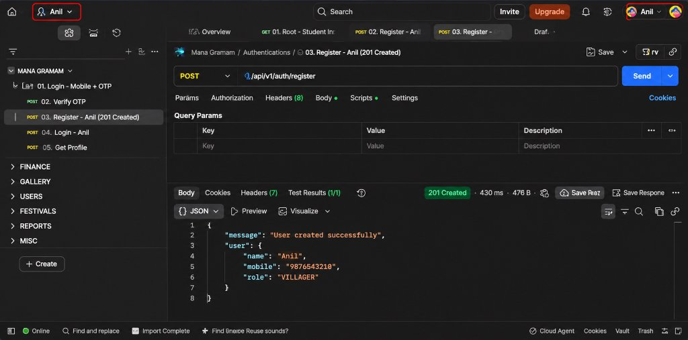
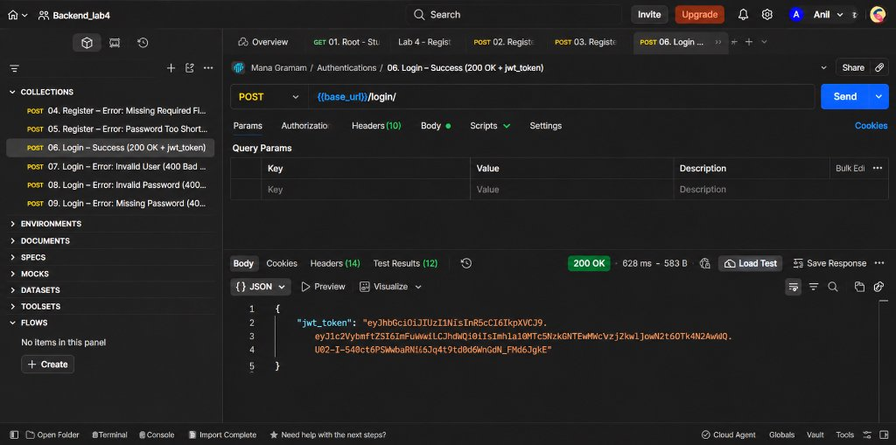

# Lab 4: Registration, Login and JWT

## 📋 Student Information

| Field | Details |
| :--- | :--- |
| **Name** | Anil Kumar Regula |
| **Registration Number** | 252U1R1221 |
| **Section** | CSE-2E 211 |
| **Course** | Backend Development Fundamentals · Year II Term II |
| **Faculty** | Mr Yugandhar Gurjalwar |
| **College** | Aurora Deemed-to-be-University |

---

## 1. Project Overview

This project is a complete backend authentication system built using **Node.js**, **Express.js**, **SQLite3**, **bcrypt**, and **jsonwebtoken (JWT)**. 

The application implements industry-standard authentication patterns:
1. **User Registration:** Securely accepts new user credentials, verifies uniqueness of the username, hashes the password with `bcrypt`, and persists records in SQLite.
2. **User Login:** Authenticates existing users by fetching their hashed password and verifying it using `bcrypt.compare()`.
3. **JWT Generation:** Generates a signed, tamper-evident JSON Web Token with a 1-hour expiration upon successful authentication.
4. **Security Best Practices:** Parameterized queries against SQL injection, password salting and hashing, zero exposure of credentials in responses, and separation of secrets.

---

## 2. Technology Stack

- **Runtime:** Node.js (v24.x)
- **Framework:** Express.js (v5.x)
- **Database:** SQLite3
- **Password Hashing:** `bcrypt` (Salt rounds: 10)
- **Authentication Token:** `jsonwebtoken` (HMAC SHA-256)
- **API Testing:** Postman

---

## 3. Project Structure

```text
backend-lab/
└── lab-04/
    ├── server.js           # Main Express server and API routes
    ├── database.js         # SQLite database initialization & helper utilities
    ├── test_suite.js       # Automated end-to-end verification script
    ├── package.json        # Project metadata and dependencies
    ├── README.md           # Comprehensive lab documentation & guide
    ├── .gitignore          # Git exclusion rules (node_modules, .env, DB files)
    └── screenshots/        # Postman test execution screenshots
        ├── 01_register_success.png
        ├── 02_register_duplicate.png
        ├── 03_register_missing_fields.png
        ├── 04_login_success.png
        ├── 05_login_wrong_password.png
        ├── 06_login_unknown_user.png
        └── 07_login_missing_fields.png
```

---

## 4. Database Design & Setup

The application uses an SQLite database named `userData.db`. SQLite creates the database file automatically on startup if it does not already exist.

### Users Table Schema

```sql
CREATE TABLE IF NOT EXISTS users (
  id INTEGER PRIMARY KEY AUTOINCREMENT,
  username TEXT UNIQUE NOT NULL,
  name TEXT NOT NULL,
  password TEXT NOT NULL
);
```

### Column Specifications
| Column Name | Data Type | Constraints | Description |
| :--- | :--- | :--- | :--- |
| `id` | `INTEGER` | `PRIMARY KEY AUTOINCREMENT` | Unique identifier for each user |
| `username` | `TEXT` | `UNIQUE NOT NULL` | Unique user handle (indexed for fast lookups) |
| `name` | `TEXT` | `NOT NULL` | Full name of the user |
| `password` | `TEXT` | `NOT NULL` | Bcrypt salted and hashed password string |

> **Security Note:** Plain-text passwords are **never** stored. Only the irreversible bcrypt hash string (which includes the salt and algorithm parameters) is saved in the database.

---

## 5. Installation & Running Instructions

### Step 1: Open the Project Directory
Open your terminal and navigate to the `lab-04` folder:
```bash
cd backend-lab/lab-04
```

### Step 2: Install Dependencies
Install all required Node.js packages:
```bash
npm install
```

### Step 3: Run the Server
To start the production server:
```bash
npm start
```
Alternatively, to start the development server with auto-reload:
```bash
npm run dev
```

The server will listen at:
```text
http://localhost:3000
```

### Step 4: Run the Automated Verification Suite
To verify all requirements and test cases automatically:
```bash
npm test
```

---

## 6. API Endpoints Specification

| Method | Endpoint | Description | Status Codes |
| :--- | :--- | :--- | :--- |
| `GET` | `/` | API Health Check | `200 OK` |
| `POST` | `/register/` | Register a new user | `200 OK` / `400 Bad Request` |
| `POST` | `/login/` | Authenticate user & issue JWT | `200 OK` / `400 Bad Request` |

---

## 7. Sample Request and Response JSON

### 1. User Registration (`POST /register/`)

#### Request:
- **URL:** `http://localhost:3000/register/`
- **Method:** `POST`
- **Headers:** `Content-Type: application/json`
- **Body:**
```json
{
  "username": "anil",
  "name": "Anil Kumar",
  "password": "Anil@123"
}
```

#### Successful Response (`200 OK`):
```json
{
  "message": "User registered successfully"
}
```

#### Error: Duplicate Username (`400 Bad Request`):
```json
{
  "error": "Username already exists"
}
```

#### Error: Missing Required Fields (`400 Bad Request`):
```json
{
  "error": "Missing required fields: username, name, and password are required"
}
```

---

### 2. User Login (`POST /login/`)

#### Request:
- **URL:** `http://localhost:3000/login/`
- **Method:** `POST`
- **Headers:** `Content-Type: application/json`
- **Body:**
```json
{
  "username": "anil",
  "password": "Anil@123"
}
```

#### Successful Response (`200 OK`):
```json
{
  "jwt_token": "eyJhbGciOiJIUzI1NiIsInR5cCI6IkpXVCJ9.eyJ1c2VybmFtZSI6ImFuaWwiLCJpYXQiOjE3MD...",
}
```

#### Error: Unknown Username (`400 Bad Request`):
```json
{
  "error": "Invalid user"
}
```

#### Error: Incorrect Password (`400 Bad Request`):
```json
{
  "error": "Invalid password"
}
```

#### Error: Missing Fields (`400 Bad Request`):
```json
{
  "error": "Missing required fields: username and password are required"
}
```

---

## 8. JWT Token Understanding

A **JSON Web Token (JWT)** is an open standard (RFC 7519) that defines a compact and self-contained way for securely transmitting information between parties as a JSON object.

A JWT consists of three parts separated by dots (`.`):
```text
<Header>.<Payload>.<Signature>
```

### The Three Components:

1. **Header:**
   - Contains the metadata for the token.
   - Typically consists of two parts: the signing algorithm being used (e.g., `HMAC SHA256` or `HS256`) and the token type (`JWT`).
   - Example:
     ```json
     {
       "alg": "HS256",
       "typ": "JWT"
     }
     ```

2. **Payload:**
   - Contains the claims (the statements about an entity/user and additional metadata).
   - In our application, it contains **only the username** (`{ "username": "anil" }`) and standard timestamps: `iat` (issued at) and `exp` (expiration time).
   - **Crucial Rule:** Never store sensitive data (such as passwords, secret keys, or credit card numbers) in the payload, because the payload is easily readable by anyone who decodes the token.

3. **Signature:**
   - Created by taking the encoded header, the encoded payload, a secret key, and the algorithm specified in the header, and signing them.
   - Example calculation:
     ```javascript
     HMACSHA256(
       base64UrlEncode(header) + "." + base64UrlEncode(payload),
       JWT_SECRET
     )
     ```
   - The signature is used by the server to verify that the sender of the JWT is who it says it is and to ensure that the message wasn't changed along the way.

### Decoding vs Verifying

- **Decoding:** Any token can be pasted into [https://jwt.io/](https://jwt.io/) and decoded into plain text immediately.
- **Verification:** **Decoding a JWT does NOT mean its signature has been verified.** Anyone can alter the JSON payload and re-encode it in base64. Verification requires using the server's secret key (`jwt.verify()`) to confirm that the payload was genuinely signed by the server and has not been tampered with.

---

## 9. Core Implementation Concepts (For Lab Viva)

### 1. `express.json()` Middleware
- Incoming HTTP requests carry data as streams of text/bytes.
- `app.use(express.json())` parses incoming requests with JSON payloads and populates `req.body` with a usable JavaScript object. Without this middleware, `req.body` will be `undefined`.

### 2. `bcrypt.hash(password, saltRounds)`
- Converts a human-readable password into an irreversible, salted cryptographic hash string.
- The `saltRounds` (cost factor = 10) controls the time needed to compute the hash, making brute-force and dictionary attacks computationally infeasible.

### 3. `bcrypt.compare(enteredPassword, storedHash)`
- Bcrypt hashes cannot be decrypted.
- To verify a login attempt, `bcrypt.compare()` extracts the salt from the stored hash, hashes the newly entered password with that same salt, and compares the resulting hashes in constant time to prevent timing attacks.

### 4. `jwt.sign(payload, secretKey, options)`
- Generates a signed cryptographic token containing the provided payload.
- We set `{ expiresIn: '1h' }` so that if a token is intercepted, its validity window is strictly limited.

### 5. Parameterized SQL Queries
- Instead of concatenating variables directly into queries (`"SELECT * FROM users WHERE username = '" + username + "'"`), we use `?` placeholders:
  ```javascript
  db.get('SELECT * FROM users WHERE username = ?', [username]);
  ```
- The SQLite engine treats user inputs purely as literal data values, entirely preventing SQL Injection vulnerabilities.

---

## 10. Postman Testing Guide

Follow these steps in Postman to capture test screenshots:

### Test 1: Successful Registration
1. **Method:** `POST`
2. **URL:** `http://localhost:3000/register/`
3. **Headers:** `Content-Type: application/json`
4. **Body (raw JSON):**
   ```json
   {
     "username": "anil",
     "name": "Anil Kumar",
     "password": "Anil@123"
   }
   ```
5. **Expected Status:** `200 OK`
6. **Expected Body:**
   ```json
   {
     "message": "User registered successfully"
   }
   ```
7. **Action:** Save screenshot as `screenshots/01_register_success.png`.

---

### Test 2: Duplicate Username Registration
1. **Method:** `POST`
2. **URL:** `http://localhost:3000/register/`
3. **Headers:** `Content-Type: application/json`
4. **Body (raw JSON):** Send the exact same body as Test 1.
5. **Expected Status:** `400 Bad Request`
6. **Expected Body:**
   ```json
   {
     "error": "Username already exists"
   }
   ```
7. **Action:** Save screenshot as `screenshots/02_register_duplicate.png`.

---

### Test 3: Missing Fields During Registration
1. **Method:** `POST`
2. **URL:** `http://localhost:3000/register/`
3. **Body (raw JSON):**
   ```json
   {
     "username": "anil_incomplete"
   }
   ```
4. **Expected Status:** `400 Bad Request`
5. **Action:** Save screenshot as `screenshots/03_register_missing_fields.png`.

---

### Test 4: Successful Login (JWT Token)
1. **Method:** `POST`
2. **URL:** `http://localhost:3000/login/`
3. **Headers:** `Content-Type: application/json`
4. **Body (raw JSON):**
   ```json
   {
     "username": "anil",
     "password": "Anil@123"
   }
   ```
5. **Expected Status:** `200 OK`
6. **Expected Body:**
   ```json
   {
     "jwt_token": "<generated_jwt_token_string>"
   }
   ```
7. **Action:** Save screenshot as `screenshots/04_login_success.png`.

---

### Test 5: Login with Wrong Password
1. **Method:** `POST`
2. **URL:** `http://localhost:3000/login/`
3. **Body (raw JSON):**
   ```json
   {
     "username": "anil",
     "password": "WrongPassword123"
   }
   ```
4. **Expected Status:** `400 Bad Request`
5. **Expected Body:**
   ```json
   {
     "error": "Invalid password"
   }
   ```
6. **Action:** Save screenshot as `screenshots/05_login_wrong_password.png`.

---

### Test 6: Login with Unknown Username
1. **Method:** `POST`
2. **URL:** `http://localhost:3000/login/`
3. **Body (raw JSON):**
   ```json
   {
     "username": "ghost_user",
     "password": "Password@123"
   }
   ```
4. **Expected Status:** `400 Bad Request`
5. **Expected Body:**
   ```json
   {
     "error": "Invalid user"
   }
   ```
6. **Action:** Save screenshot as `screenshots/06_login_unknown_user.png`.

---

### Test 7: Login Missing Fields
1. **Method:** `POST`
2. **URL:** `http://localhost:3000/login/`
3. **Body (raw JSON):**
   ```json
   {
     "username": "anil"
   }
   ```
4. **Expected Status:** `400 Bad Request`
5. **Action:** Save screenshot as `screenshots/07_login_missing_fields.png`.

---

## 11. Test Screenshots

Add the Postman screenshots to the `screenshots/` directory using these filenames:

| Test Case | Screenshot |
| :--- | :--- |
| **01. Successful Registration** |  |
| **02. Duplicate Username Registration** |  |
| **03. Registration Missing Fields** |  |
| **04. Successful Login & JWT Token** |  |
| **05. Login with Wrong Password** |  |
| **06. Login with Unknown Username** |  |
| **07. Login Missing Fields** |  |

---

## 12. Problems Faced and Solutions

1. **Problem:** Asynchronous nature of database queries in SQLite3 caused route handlers to send responses before query results were available.  
   **Solution:** Created promise-based helper functions (`dbGet` and `dbRun`) wrapping SQLite's native callback methods, allowing modern and readable `async/await` syntax inside Express route handlers.

2. **Problem:** Trailing slash inconsistencies (`/register` vs `/register/`) in Postman requests resulting in unexpected 404 responses depending on client URL formatting.  
   **Solution:** Registered handlers for both `/register` and `/register/`, as well as `/login` and `/login/`, ensuring complete compatibility regardless of URL slashes.

3. **Problem:** Risk of exposing sensitive information such as hashed passwords in responses.  
   **Solution:** Formatted responses explicitly to return only user feedback messages and the issued `jwt_token`.

---

## 13. Deployment Status

- **Live Deployment URL:** *Not Applicable*  
- **Explanation:** This project is an internal university laboratory assignment designed for local development and testing using SQLite and local Express instances. Cloud hosting (such as Render, Vercel, or AWS) is slated for subsequent lab modules.

---

## 14. GitHub Submission & Git Workflow

### Suggested Git Commit Commands:
```bash
# Navigate to the repository root (backend-lab)
cd backend-lab

# Check status
git status

# Stage files for Lab 4
git add lab-04/

# Commit with a descriptive message
git commit -m "feat(lab-04): complete user registration, login and JWT authentication"

# Push to your remote repository
git push origin main
```

